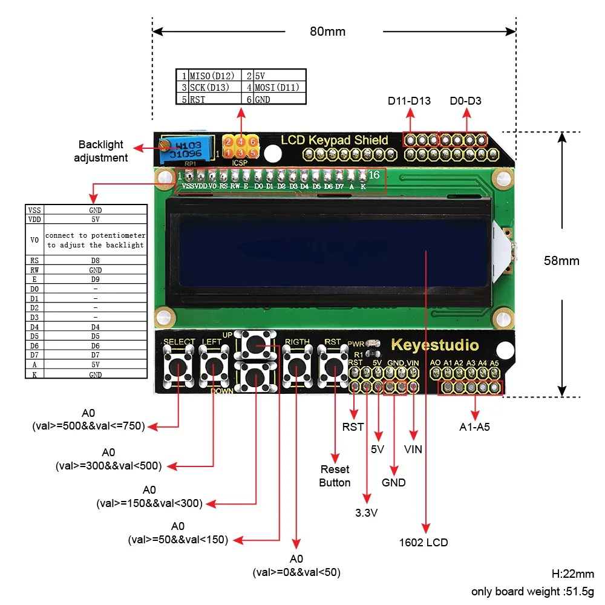

# Prey-Predator Fuzzy Logic Control System

[](https://github.com/gokeranok-ui)

[Published Electronics article](https://gokeranok-ui.github.io/prey-predator/) · [Predator–prey paper (AI reproduction)](https://gokeranok-ui.github.io/prey-predator/predator-prey.html)

[MATLAB-generated C](opkene.c) · [MATLAB-generated C++](opkene.cpp) · [Download source ZIP](https://github.com/gokeranok-ui/prey-predator/raw/refs/heads/main/Fuzzy_Inference_Source.zip)

If this paper, code, or model helps you in your research, please cite Goker Ariyak’s article in *Electronics* 15(22), 5297 (2026). Thank you for crediting this work. [DOI 10.3390/electronics15225297](https://doi.org/10.3390/electronics15225297) · [Email Goker ARIYAK](https://gokeranok-ui.github.io/prey-predator/#contact)

### STM32F469 companion project

The [companion repository](https://github.com/gokeranok-ui/gpt) contains the STM32F469 firmware described in Section 6 and Table 10 of the paper. At commit `65209fe`, `gpt/Core/Src/opkene.c` is the MATLAB-generated C entry point. The board adapter in `gpt/Core/Src/fis_virtual_fs.c` lets the parser open an embedded copy of `fismat.fis` by name.

The companion repository requires access. Anyone can download the [public source ZIP](https://github.com/gokeranok-ui/prey-predator/raw/refs/heads/main/Fuzzy_Inference_Source.zip). Open `02_original_core/` for the original generated C and headers, or `03_stm32f469/Core/Src/` for the later board implementation that loads a model from an SD card.

## 📖 Project Story

The project draws on fuzzy control of predator and prey populations. The repository includes an AI-generated reproduction of the background reading. The exposition presents a theoretical framework for using fuzzy logic to control ecological population dynamics in predator-prey systems, and we wondered: *"Can we implement this on a real embedded system?"*

### The Journey

**From Paper to Prototype**

The journey began with reading the research paper, which described a Mamdani-type fuzzy inference system for managing predator and prey populations. The elegance of the approach—using linguistic rules instead of complex mathematical models—inspired us to create a practical implementation.

**Simulink + Waijung Blockset: A Successful Approach**

We chose to implement this using **MATLAB Simulink** with the **Waijung Blockset**, an open-source solution for embedded code generation targeting STM32 microcontrollers. This choice proved to be highly successful:

- ✅ **Graphical Modeling**: Visual representation of the fuzzy logic system
- ✅ **Automatic Code Generation**: From Simulink model to production-ready C code
- ✅ **Hardware Integration**: Direct support for LCD displays, buttons, and other peripherals
- ✅ **Real-Time Execution**: Successfully deployed on STM32F4 Discovery board

**Hardware Realization**

The fuzzy logic controller was successfully implemented on the **STM32F4 Discovery board** (STM32F407VG, Cortex-M4 @ 168 MHz). The system uses:

- **LCD Display**: 16x2 Character LCD with keypad shield for real-time visualization
- **Interactive Control**: Button inputs for testing different scenarios
- **Real-Time Feedback**: Live display of fuzzy inference outputs


*Figure 1: STM32F4 Discovery board successfully running the prey-predator fuzzy controller with LCD keypad shield*

### Alternative Hardware Configurations

**16-Pin LCD Configuration**

The project can also work with standard 16-pin LCD modules. The Simulink model and generated code support both configurations:

- 4-bit parallel interface (current implementation)
- Full 8-bit parallel interface (configurable)

**I2C Module Option**

To reduce cable complexity and simplify wiring, you can use an **I2C LCD backpack module** connected to the STM32F4 Discovery board's I2C interface. This approach:

- Reduces wiring from 6+ wires to just 2 (SDA and SCL)
- Provides cleaner hardware setup
- Maintains full functionality



*Figure 2: LCD specifications and pinout information*

## 🎯 Project Overview

This project demonstrates a **fuzzy logic control system for predator-prey population dynamics** running on an embedded STM32F4 microcontroller. The system:

- Takes two inputs: **Prey population** (X1) and **Predator population** (X2)
- Produces two outputs: **Recommended change in Prey** (ΔX1) and **Recommended change in Predator** (ΔX2)
- Uses **Mamdani fuzzy inference** with centroid defuzzification
- Runs in **real-time** at 100 Hz (10 ms sample period)

### Fuzzy System Specifications

**Input Variables:**
- **X1 (Prey)**: Range [0, 5000] with 5 membership functions (S, MS, M, ML, L)
  - **Default Implementation Value**: 3200
- **X2 (Predator)**: Range [0, 3000] with 5 membership functions (S, MS, M, ML, L)
  - **Default Implementation Value**: 1300

**Output Variables:**
- **ΔX1 (Change in Prey)**: Range [-800, 800]
- **ΔX2 (Change in Predator)**: Range [-400, 400]

**Inference Rules:** 4 fuzzy rules implementing ecological control logic

### Default Implementation Values

This project was implemented using the following input values:
- **Prey Population (X1)**: **3200**
- **Predator Population (X2)**: **1300**

These values are within the admissible region defined by the fuzzy logic system's membership functions and provide a good demonstration of the control system behavior.

### Modifying Input Values

Users can modify these input values within the admissible region (as defined by the fuzzy system's input ranges) by following these steps:

1. **Open the Simulink Model:**
   - Open `PreyPredator/Prey_Predator_STM32F4.slx` in MATLAB Simulink

2. **Locate the Constant Blocks:**
   - Find the two constant blocks currently set to:
     - **3200** (for Prey population)
     - **1300** (for Predator population)

3. **Replace with Memory Blocks L and M:**
   - Replace the constant block for Prey (3200) with a **Memory block labeled L**
   - Replace the constant block for Predator (1300) with a **Memory block labeled M**
   - Assign new values to memory blocks L and M within the admissible ranges:
     - **Memory Block L (Prey)**: Any value in range [0, 5000]
     - **Memory Block M (Predator)**: Any value in range [0, 3000]

4. **Rebuild the Model:**
   - After modifying the memory blocks, rebuild the Simulink model (Ctrl+B)
   - The generated code will use the new values assigned to memory blocks L and M

**Note:** Users can change the input numbers by creating **L and M storages** and feed the fuzzy inputs by these new storage values. This approach allows flexible testing of different predator-prey population scenarios while maintaining the system's fuzzy logic control structure within the admissible region.

## ⚡ Performance Metrics

### Execution Time Analysis

One of the key achievements of this project was demonstrating that fuzzy logic inference can run efficiently on resource-constrained embedded systems:

- **Execution Time**: ~**0.36 ms** per inference cycle
- **CPU Utilization**: < **4%** (3.6% actual)
- **Sample Rate**: 100 Hz (10 ms period)
- **Deterministic**: Fixed execution path with no dynamic memory allocation

**Performance Breakdown:**
- Membership function evaluation: ~500 cycles
- Rule evaluation: ~80 cycles  
- Consequent evaluation & aggregation: ~8,080 cycles
- Defuzzification: ~2,020 cycles
- Hardware I/O overhead: ~50,000 cycles
- **Total**: ~60,680 cycles ≈ 0.36 ms @ 168 MHz

This demonstrates that fuzzy logic control is **well-suited for real-time embedded applications**, with plenty of headroom for additional processing or higher sample rates.


*Figure 3: Simulation results showing fuzzy inference behavior*


*Figure 4: System hardware setup showing the integrated controller*

## 🛠️ Technical Implementation

### Toolchain

- **MATLAB R2025a** with Simulink
- **Waijung Blockset 18.11a** for STM32F4 target
- **GNU ARM Embedded Toolchain** for compilation
- **ST-Link** for programming

### Code Generation

The project demonstrates successful **Model-Based Design** workflow:

1. **Modeling**: Fuzzy logic system designed in Simulink using Waijung blocks
2. **Code Generation**: Automatic C code generation using Real-Time Workshop (RTW)
3. **Compilation**: Generated code compiled for STM32F4 target
4. **Deployment**: Binary flashed to hardware and tested in real-time

**Generated Code Structure:**
- `Prey_Predator_STM32F4.c`: Main fuzzy logic implementation (~4,000 lines)
- `main.c`: Real-time execution loop with SysTick interrupt
- `Prey_Predator_STM32F4_data.c`: Membership function parameters and rule base
- Hardware driver libraries: Waijung HAL drivers for LCD and I/O

### Fuzzy Logic Implementation

The system implements a complete Mamdani fuzzy inference engine:

1. **Fuzzification**: Input values converted to membership degrees (10 MFs total)
2. **Rule Evaluation**: 4 rules evaluated using MIN operator for AND logic
3. **Implication**: Rule consequents clipped using MIN operator
4. **Aggregation**: Rule outputs combined using MAX operator
5. **Defuzzification**: Centroid method with 101 sample points per output

## 📁 Repository Structure

[Published Electronics article](https://gokeranok-ui.github.io/prey-predator/) · [Predator–prey paper (AI reproduction)](https://gokeranok-ui.github.io/prey-predator/predator-prey.html)

[MATLAB-generated C](opkene.c) · [MATLAB-generated C++](opkene.cpp) · [Download source ZIP](https://github.com/gokeranok-ui/prey-predator/raw/refs/heads/main/Fuzzy_Inference_Source.zip)

```
prey-predator/
├── electronics-15-05297.pdf            # Published Electronics article
├── opkene.c                            # Generated C entry point
├── opkene.cpp                          # Generated C++ entry point
├── Fuzzy_Inference_Source.zip          # Source and supporting files
├── README.md                           # This file
├── prey.pdf                            # AI-generated reproduction
├── Prey_Predator_STM32FDISCO.jpg       # Hardware setup photo
├── LCD_specs.jpg                       # LCD specifications
├── sim1.jpg                            # Simulation results
├── SH1.jpg                             # System hardware photo
├── PreyPredator/                       # Simulink project files
│   ├── Prey_Predator_STM32F4.slx       # Main Simulink model
│   ├── fismat.fis                      # Fuzzy Inference System definition
│   └── predator_prey.m                 # Original MATLAB script
└── [additional documentation...]
```

## 🚀 Getting Started

### Prerequisites

- MATLAB R2025a (or compatible version) with Simulink
- Waijung Blockset 18.11a installed
- STM32F4 Discovery Board
- 16x2 LCD with keypad shield (or standard 16-pin LCD)
- ST-Link programmer
- Optional: I2C LCD backpack module for simplified wiring

### Building the Project

1. **Open Simulink Model**:
   ```matlab
   open('PreyPredator/Prey_Predator_STM32F4.slx')
   ```

2. **Build for STM32F4**:
   - Select Waijung STM32F4 target
   - Press `Ctrl+B` to build
   - Generated code will be in `Prey_Predator_STM32F4_stm32f4/` directory

3. **Flash to Hardware**:
   - Use ST-Link utility to flash the generated `.hex` file
   - Connect LCD and buttons according to pin mapping

4. **Run**:
   - System starts automatically with default input values (Prey: 3200, Predator: 1300)
   - LCD displays fuzzy inference outputs in real-time
   - To modify input values, edit the Simulink model as described in the "Modifying Input Values" section above

### Hardware Connections

**LCD Keypad Shield (Current Setup):**
- RS: PE7
- Enable: PE9
- Data (D4-D7): PE12-PE15

**Alternative: Standard 16-Pin LCD**
- Same pin mapping as above, or
- Configure for 8-bit mode if desired

**Alternative: I2C LCD Module**
- Connect to I2C1 or I2C2 on STM32F4 Discovery
- Modify Simulink model to use I2C LCD block
- Requires I2C LCD library driver

## 📊 Research Contributions

This project demonstrates:

1. **✅ Successful Code Generation**: From Simulink graphical models to embedded C code
2. **✅ Real-Time Performance**: Sub-millisecond fuzzy inference on microcontroller
3. **✅ Practical Application**: Ecological control system running on embedded hardware
4. **✅ Alternative Workflow**: Model-based design for fuzzy logic systems

### For Journal Publication

This implementation serves as a **proof-of-concept** showing that:

- Fuzzy logic controllers can be deployed on embedded systems via graphical modeling tools
- Simulink with Waijung Blockset provides a viable path from model to hardware
- Real-time performance is achievable with minimal CPU overhead
- The approach is accessible to engineers familiar with Simulink but new to embedded C programming

## 📚 References

1. [Fuzzy Logic Control for Predator–Prey Systems (Reproduced and Modernized Exposition)](https://gokeranok-ui.github.io/prey-predator/predator-prey.html). AI-generated reproduction.

2. **Waijung Blockset Documentation**: [https://waijung.aimagin.com/](https://waijung.aimagin.com/)

3. **STM32F4 Discovery Board User Manual**: STMicroelectronics

4. **MATLAB Simulink Real-Time Workshop**: MathWorks Documentation

## 📝 Notes

- This code is **auto-generated** from Simulink model using MATLAB Real-Time Workshop
- The fuzzy logic implementation follows **Mamdani inference** methodology
- Code is optimized for **real-time execution** on STM32F4 (168 MHz Cortex-M4)
- System runs at **100 Hz** with deterministic execution time
- **Input Modification**: Users can change the input numbers by creating **L and M storages** and feed the fuzzy inputs by these new storage values

## 👤 Author

**Goker ARIYAK**

[Email the author](https://gokeranok-ui.github.io/prey-predator/#contact) · [GitHub profile](https://github.com/gokeranok-ui)

## 📄 License

This project includes code generated from MATLAB/Simulink and Waijung Blockset. Please refer to:
- MATLAB/Simulink licensing terms (MathWorks)
- Waijung Blockset licensing terms
- STMicroelectronics HAL driver licensing (SLA0044)

The published article is licensed under [CC BY 4.0](https://creativecommons.org/licenses/by/4.0/). The AI reproduction is outside the project's MIT grant. Generated source and the source ZIP retain their applicable component terms. See [LICENSE](LICENSE).

## 🙏 Acknowledgments

- **Bojadziev** for the inspiring research paper on fuzzy control for predator-prey systems
- **Waijung Blockset team** for providing excellent embedded code generation tools
- **STMicroelectronics** for STM32F4 Discovery board and HAL drivers
- **MathWorks** for MATLAB Simulink and Real-Time Workshop

---

**Last Updated**: November 14, 2026  
**Project Status**: [Published in Electronics](https://doi.org/10.3390/electronics15225297)  
**Hardware Validated**: ✅ STM32F4 Discovery Board  
**Performance Verified**: ✅ Real-time execution confirmed
