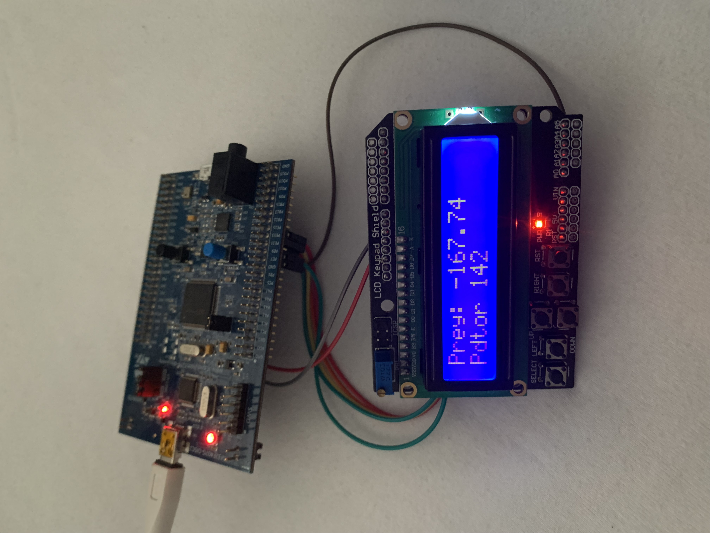
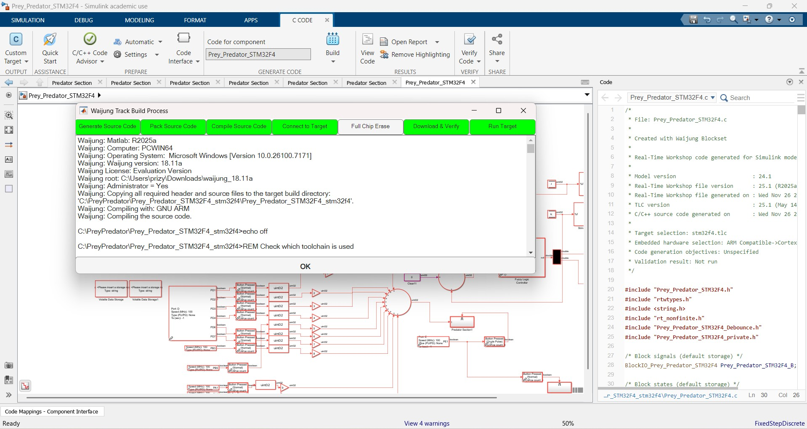

# Reusable MATLAB-generated fuzzy inference in C and C++

**You can build a MATLAB-designed fuzzy controller with your board’s own C or C++ compiler and run it without installing MATLAB on the device.** We used the licensed Fuzzy Logic Toolbox and MATLAB Coder products to generate the code that reads a compatible `.fis` file, evaluates its membership functions and rules, and returns the outputs. Starting from the published C or C++ sources, you can compile them with your own tools without purchasing the toolbox to perform that build. MathWorks describes deployment of MATLAB Coder output as royalty-free. The supplied files retain their individual license terms. [Fuzzy Logic Toolbox](https://www.mathworks.com/products/fuzzy-logic.html) · [MATLAB Coder deployment](https://www.mathworks.com/products/matlab-coder.html) · [Repository license](LICENSE)

The same evaluator can run different supported type-1 Mamdani or Sugeno controllers by loading a different model file. To bring it to another board, connect the file and I/O interfaces and allow enough memory for the parser and inference buffers. The projects below show that process on microcontrollers and on Linux. The [phone workflow](#manual-model-entry-and-an-iot-update) shows how a model could be authored remotely and delivered to an IoT device.

[Browse MATLAB-generated C](matlab-c/) · [Browse MATLAB-generated C++](matlab-cpp/) · [Browse public STM32F469 firmware (gpt)](https://github.com/gokeranok-ui/prey-predator/tree/main/gpt) · [Download the source ZIP](https://github.com/gokeranok-ui/prey-predator/raw/refs/heads/main/Fuzzy_Inference_Source.zip)

[Read the published article](https://gokeranok-ui.github.io/prey-predator/) · [Read the predator–prey background paper (AI reproduction)](https://gokeranok-ui.github.io/prey-predator/predator-prey.html) · [Email Goker ARIYAK](https://gokeranok-ui.github.io/prey-predator/#contact)

## From a MATLAB function to native source

The MATLAB entry point takes the model filename at run time. The first call below reads the fuzzy inference system (FIS), the second selects 51 output sample points for Mamdani defuzzification, and the third evaluates the inputs. [Original MATLAB function](generation/opkene.m)

```matlab
fis = getFISCodeGenerationData(fileName);
opt = evalfisOptions('NumSamplePoints',51);
y = evalfis(fis,x,opt);
```

The build declares a variable-length filename and input vector, then runs `codegen -config cfg opkene -args {fileName,x}` for C. Selecting `cfg.TargetLang = 'C++'` generates C++ with the corresponding application wrapper. The archived scripts show the custom entry files and include paths used for each build. [C generation recipe](generation/runn.m) · [C++ generation recipe](matlab-cpp/runn.m) · [Paper, Section 3.1](https://gokeranok-ui.github.io/prey-predator/electronics-15-05297.pdf#page=3)

For the STM32F469 integration, all 107 original C and header files had counterparts in the board project. After line-ending normalization, 98 were identical.

## Embedded implementations

| Target | How the application uses fuzzy inference | What the project records |
| --- | --- | --- |
| [STM32F469 · STM32CubeIDE](gpt/) | The application calls generated C and presents a model file to the parser. The public version reads from an SD card using FatFs. | An archived board run and a comparison of the generated files with the board sources. |
| [Digix SAM3X8E · Arduino](platforms/ArduFuzzy/) | The Arduino C++ sketch calls the generated C runtime through `extern "C"`. The sketch handles serial and display I/O. | Physical execution of the `tipper.fis` model on the 84 MHz SAM board using Arduino Due support. |
| [Raspberry Pi 3 Model B · Linux](platforms/raspberry-pi/) | GCC and Make build the generated C and its runner into `fuzzy_cli`. The command-line application accepts a model path and numeric inputs. | Ten archived runner calls averaged **3.0262 ms**, including model parsing and allocation. |
| [ESP32 · Arduino](matlab-cpp/mainn.ino) | The sketch calls the generated C++ evaluator with model and input files in SPIFFS. The main loop services an FTP server over Wi-Fi. | The integration source and a firmware inventory for a DOIT ESP32 DevKit V1. Physical inference and a complete network model update remain unverified. |

The historical board runs used different models and timed different operations. The later validation work identified a file-reading defect that could skip the final rule. On the corrected host build, one executable completed 1,000 tipper–FISMAT–tipper cycles and checked all 3,000 evaluations. The paper reports the board records and the corrected host results separately. [Board results, Table 3](https://gokeranok-ui.github.io/prey-predator/electronics-15-05297.pdf#page=8) · [File-reading corrections and model switching](https://gokeranok-ui.github.io/prey-predator/electronics-15-05297.pdf#page=11)

### STM32F469 companion project

The paper cites an STM32F469 implementation that reads an embedded fuzzy model from board memory. You can browse that version in the [original gpt repository](https://github.com/gokeranok-ui/gpt) or open the [exact revision cited in the paper](https://github.com/gokeranok-ui/gpt/tree/65209fef3511e48a088f6ba5c06afdf459537119). The board project included here is the later version that reads its model from an SD card. [SD-card project](https://github.com/gokeranok-ui/prey-predator/tree/main/gpt) · [Application sources](gpt/Core/Src/) · [Headers](gpt/Core/Inc/) · [SD-card adapter](gpt/Core/Src/fis_virtual_fs.c)

### Build the Raspberry Pi example

The archived timing runs used a **Raspberry Pi 3 Model B**, identified by hardware revision `a02082`. The run notes in `07_records/Pi_original_notes.md` record a 64-bit ARM Cortex-A53, Debian GNU/Linux 13 (*Trixie*) and Raspberry Pi kernel `6.12.47+rpt-rpi-v8` (`aarch64`). Use 64-bit Raspberry Pi OS based on Trixie to match that environment. The build uses GCC in C11 mode, GNU Make and the system math library. [Raspberry Pi revision codes](https://www.raspberrypi.com/documentation/computers/raspberry-pi.html#new-style-revision-codes-in-use) · [Project Makefile](platforms/raspberry-pi/Makefile)

On the Pi, install `build-essential` if GCC and Make are missing. From the root of a downloaded or cloned copy of this repository, these commands build the example and evaluate **service = 2** and **food = 10**.

```sh
cd platforms/raspberry-pi
make
./fuzzy_cli --fis disk_tipper.fis 2 10
```

To enter more samples interactively, run `./fuzzy_cli --fis disk_tipper.fis` and type a pair of values at each prompt. This directory preserves the historical implementation used in the study. The paper documents the final-rule parsing correction and the corrected host outputs in Section 4.2.1. [Command-line runner](platforms/raspberry-pi/linux_cli.c) · [File-reading correction](https://gokeranok-ui.github.io/prey-predator/electronics-15-05297.pdf#page=11)

### Arduino Mega 2560 and Digix SAM3X8E

The Mega 2560 build compiled and accepted serial input. On entering inference, the board restarted before returning an output. Its 8-bit AVR has **8 KiB of SRAM** shared by the parser, dynamic arrays and stack. The restart is consistent with memory pressure, although the run did not establish its exact cause. The successful Digix board uses a **32-bit SAM3X8E Cortex-M3 at 84 MHz with 96 KiB of SRAM** and returned outputs repeatedly for `tipper.fis`. [Paper, Sections 3.2.2 and 5](https://gokeranok-ui.github.io/prey-predator/electronics-15-05297.pdf#page=6) · [Mega specifications](https://docs.arduino.cc/hardware/mega-2560) · [Due/SAM specifications](https://docs.arduino.cc/hardware/due)

To follow the Digix implementation, open `ArduFuzzy.ino` in the Arduino IDE, select the Arduino Due (Native USB Port) configuration from the Arduino SAM Boards package, and install the U8g2 library used by the display. Connect to the native USB port and open the serial monitor at 115200 baud. The sketch accepts two numeric inputs and calls the generated C routines through C linkage. [Browse the sketch](platforms/ArduFuzzy/ArduFuzzy.ino) · [Browse its C runtime](platforms/ArduFuzzy/src/runtime/)

## Manual model entry and an IoT update

The three MATLAB® screenshots below show how to specify a fuzzy inference system (FIS). In this example, `avr` is a Mamdani controller with one input and one output. Each screenshot opens at full size.

| Choose the inference settings | Define the membership functions | Enter the rules |
| --- | --- | --- |
| [![Fuzzy Logic Designer showing the avr input, Mamdani controller and output][avr-system]][avr-system] | [![Membership Function Editor showing seven input terms, with the EL trapezoid selected][avr-terms]][avr-terms] | [![Rule Editor showing seven rules, with the rule mapping L to F selected][avr-rules]][avr-rules] |
| The controller uses minimum for implication, maximum for aggregation and centroid defuzzification. | The input spans −0.1 to 1. The four breakpoints for the `EL` trapezoid are `[-0.1, -0.1, 0.025, 0.15]`. | The highlighted rule reads `IF input IS L THEN output IS F`, with weight 1. |

[avr-system]: https://www.mathworks.com/matlabcentral/answers/uploaded_files/1576567/image.png
[avr-terms]: https://www.mathworks.com/matlabcentral/answers/uploaded_files/1576572/image.png
[avr-rules]: https://www.mathworks.com/matlabcentral/answers/uploaded_files/1576582/image.png

*Screenshots posted by anhpham in “How to setup fuzzy control,” MATLAB Answers, 26 December 2023. The contributor’s images are shown unmodified under CC BY-SA 3.0. The MATLAB and Fuzzy Logic Toolbox interface is © The MathWorks, Inc.* [Original post](https://www.mathworks.com/matlabcentral/answers/2064062-how-to-setup-fuzzy-control) · [CC BY-SA 3.0](https://creativecommons.org/licenses/by-sa/3.0/) · [MATLAB Central terms](https://www.mathworks.com/matlabcentral/content/terms-of-use.html)

To create a similar `.fis` file in **QtFuzzyLite**, enter the input and output ranges, give each membership function its name, shape and breakpoints, then enter the rules and select the inference methods. For example, create the input term `L` and output term `F` before entering the highlighted rule. Export the controller in FIS format and check its outputs at known inputs before loading it on the board. The generated C or C++ evaluator can then use that file. [QtFuzzyLite editor](https://fuzzylite.com/QtFuzzyLite/) · [FuzzyLite FIS export](https://github.com/fuzzylite/fuzzylite/blob/main/fuzzylite.1)

The project’s phone photographs show a different controller. Its inputs are *service* and *food*, and its output is *tip*. The plots show the membership functions above the rule list. In the paper’s proposed workflow, QtFuzzyLite runs on a desktop that the phone controls remotely. **eFLL** is a separate C++ library for defining a model in application code. [eFLL library](https://github.com/alvesoaj/eFLL)


[Second photograph showing the rule-entry area](images/phone-rule-entry.jpg)

An Android phone or iPhone could serve as the operator’s terminal wherever the desktop and target are reachable over the network.

1. **Compose the model.** From a remote-desktop app on the phone, operate QtFuzzyLite running on a desktop computer. Set the variable ranges and membership functions, then enter rules such as `IF service is excellent THEN tip is generous`. Export the finished controller as a compatible `.fis` file.
2. **Transfer the file.** Make the exported file available to the phone, then use an Android or iOS FTP client to upload it to the embedded device over a local network or an Internet connection that reaches the device. Remote desktop provides the editing controls. FTP carries the completed file.
3. **Activate the controller.** The target application would validate the received file, load it into the generated C or C++ evaluator, and check an output. This would let an operator change compatible controller rules remotely without rebuilding the device firmware.

The archived ESP32 sketch reads `/spiffs/ti.fis` and `/spiffs/x.txt` at startup, runs inference, then handles FTP requests. Activating a file uploaded during operation would require a reload step. The paper presents end-to-end phone transfer and activation as a proposed workflow. [ESP32 sketch](matlab-cpp/mainn.ino) · [File access and inference wrapper](matlab-cpp/opkene_main.cpp) · [Published workflow, Figure 5 and Section 5.4](https://gokeranok-ui.github.io/prey-predator/electronics-15-05297.pdf#page=17)

<a href="https://docs.espressif.com/projects/esp-idf/en/v3.3.5/get-started/get-started-devkitc.html"></a>

*ESP32 hardware reference from Espressif’s DevKitC V4 guide. The project’s own firmware inventory identifies a DOIT ESP32 DevKit V1.* [Board guide](https://docs.espressif.com/projects/esp-idf/en/v3.3.5/get-started/get-started-devkitc.html) · [Archived firmware inventory](matlab-cpp/firmware_inventory.json)

## Repository structure

| Browse | Contents |
| --- | --- |
| [Generation inputs](generation/) | MATLAB entry point, original C build script, application entry file and two example FIS files. |
| [MATLAB-generated C](matlab-c/) | All 52 C source files and 55 headers. [Open the C entry point](opkene.c). |
| [MATLAB-generated C++](matlab-cpp/) | Generated C++ sources and headers, with the archived ESP32 application alongside them. [Open the C++ entry point](opkene.cpp). |
| [STM32F469](gpt/) · [SAM3X8E](platforms/ArduFuzzy/) · [Raspberry Pi](platforms/raspberry-pi/) | Browsable native projects from the public source release. |
| [Predator–prey models](PreyPredator/) | Simulink desktop and STM32F407 board models and the FIS definition. |
| [Download source ZIP](https://github.com/gokeranok-ui/prey-predator/raw/refs/heads/main/Fuzzy_Inference_Source.zip) | Source, supporting records, component notices and file checksums. |

<a name="predatorprey-controller-on-stm32f407"></a>

## Waijung and Simulink on the STM32F407 Discovery

The predator–prey controller that gives this repository its name is a second route from fuzzy design to firmware. In the published build, **MATLAB R2025a, Simulink and Aimagin Waijung Blockset 18.11a** generated a dedicated STM32F407 application from a block diagram. The model combines a four-rule Mamdani controller, input handling and LCD output in one model-step function. The portable C/C++ projects above load their model through a filename. [Paper, Section 4.1](https://gokeranok-ui.github.io/prey-predator/electronics-15-05297.pdf#page=9)

**Model and build.** In MATLAB, open the `PreyPredator` directory and load the controller with `fismat = readfis('fismat.fis');`. The desktop model shows the inference design. Open the STM32F4 board model with the Waijung target installed to inspect the hardware blocks. Its two input constants, `Clear12` and `Clear13`, start at **3,200 prey** and **1,300 predators**. Change these values to explore another input pair. Build the board model with **Ctrl+B** and program the Discovery board using ST-LINK. [Desktop model](PreyPredator/Presentation.mdl) · [Board model](PreyPredator/Prey_Predator_STM32F4.slx) · [Model parameters and rules](PreyPredator/fismat.fis)



*The prototype displays the recommended population changes on a 16×2 character LCD. The four-bit interface uses PE7 for RS, PE9 for Enable, and PE12–PE15 for D4–D7.* [LCD shield pinout](LCD_specs.jpg)

| Simulink controller and display blocks | Waijung source generation and build |
| --- | --- |
| [](sim1.jpg) | [](SH1.jpg) |

**Measured application timing.** On the 168 MHz STM32F407, the complete step averaged **7.67467 ms** over 10,000 steps after 10 warmup steps. The largest observed time was **7.73465 ms**. These measurements include inference, text formatting, LCD updates and GPIO operations. [Paper, Table 4](https://gokeranok-ui.github.io/prey-predator/electronics-15-05297.pdf#page=10)

## Citation and author

If the source, models, or measurements help you in your work, please cite the accompanying article. Thank you for crediting the research.

Goker ARIYAK. “Reusable MATLAB-Generated Fuzzy Inference for Embedded Electronics: Integration in C and C++.” *Electronics* **15**(22), 5297 (2026). [DOI 10.3390/electronics15225297](https://doi.org/10.3390/electronics15225297) · [Full article PDF](https://gokeranok-ui.github.io/prey-predator/electronics-15-05297.pdf) · [Contact the author](https://gokeranok-ui.github.io/prey-predator/#contact)

The repository license describes the MIT grant for author-owned material and the terms that apply to third-party components. The published article is available under CC BY 4.0. The AI reproduction is separate from the MIT grant. [Repository license](LICENSE) · [Article license](https://creativecommons.org/licenses/by/4.0/)
