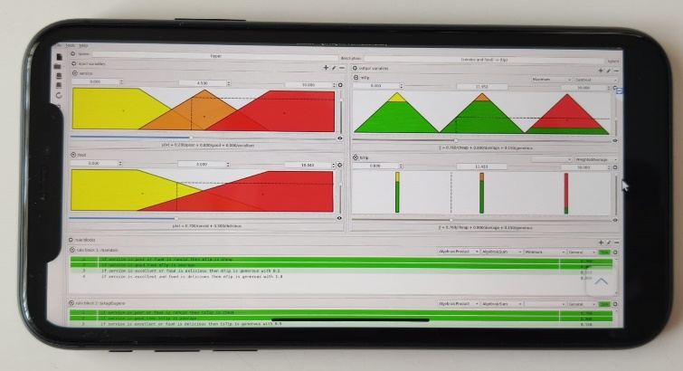

# Reusable MATLAB-generated fuzzy inference in C and C++

A fuzzy controller can store its rules in a model file and evaluate them with a reusable library. This project uses MATLAB Coder to generate native C or C++ from a short Fuzzy Logic Toolbox function. An embedded application supplies a compatible `.fis` file and an input vector, calls the generated evaluator, and receives the outputs. To port the code, the developer builds it with the target compiler and connects it to the target’s memory, file access and hardware I/O.

[Browse MATLAB-generated C](matlab-c/) · [Browse MATLAB-generated C++](matlab-cpp/) · [Download the source ZIP](https://github.com/gokeranok-ui/prey-predator/raw/refs/heads/main/Fuzzy_Inference_Source.zip)

[Read the published article](https://gokeranok-ui.github.io/prey-predator/) · [Read the predator–prey background paper (AI reproduction)](https://gokeranok-ui.github.io/prey-predator/predator-prey.html) · [Email Goker ARIYAK](https://gokeranok-ui.github.io/prey-predator/#contact)

## From a MATLAB function to native source

The MATLAB entry point takes the model filename at run time. The first call below reads the fuzzy inference system (FIS), the second selects 51 output sample points for Mamdani defuzzification, and the third evaluates the inputs. [Original MATLAB function](generation/opkene.m)

```matlab
fis = getFISCodeGenerationData(fileName);
opt = evalfisOptions('NumSamplePoints',51);
y = evalfis(fis,x,opt);
```

The build declares a variable-length filename and input vector, then runs `codegen -config cfg opkene -args {fileName,x}` for C. Selecting `cfg.TargetLang = 'C++'` generates C++ with the corresponding application wrapper. The archived scripts show the custom entry files and include paths used for each build. [C generation recipe](generation/runn.m) · [C++ generation recipe](matlab-cpp/runn.m) · [Paper, Section 3.1](https://gokeranok-ui.github.io/prey-predator/electronics-15-05297.pdf#page=3)

The generated sources contain the model parser, membership functions, rule evaluation and output calculation for supported type-1 Mamdani and Sugeno models. Passing the filename at run time lets the same executable evaluate different compatible models without regenerating its source. For the STM32F469 integration, all 107 original C and header files had counterparts in the board project. After line-ending normalization, 98 were identical.

## Embedded implementations

| Target | How the application uses fuzzy inference | What the project records |
| --- | --- | --- |
| [STM32F469 · STM32CubeIDE](gpt/) | The application calls generated C and presents a model file to the parser. The public version reads from an SD card using FatFs. | An archived board run and a comparison of the generated files with the board sources. |
| [Digix SAM3X8E · Arduino](platforms/ArduFuzzy/) | The Arduino C++ sketch calls the generated C runtime through `extern "C"`. The sketch handles serial and display I/O. | Physical execution of the `tipper.fis` model on the 84 MHz SAM board using Arduino Due support. |
| [Raspberry Pi 3 Model B · Linux](platforms/raspberry-pi/) | GCC and Make build the generated C and its runner into `fuzzy_cli`. The command-line application accepts a model path and numeric inputs. | Ten archived runner calls averaged **3.0262 ms**, including model parsing and allocation. |
| [ESP32 · Arduino](matlab-cpp/mainn.ino) | The sketch calls the generated C++ evaluator with model and input files in SPIFFS. The main loop services an FTP server over Wi-Fi. | The integration source and a firmware inventory for a DOIT ESP32 DevKit V1. Physical inference and a complete network model update remain unverified. |

The historical board runs used different models and timed different operations. The later validation work identified a file-reading defect that could skip the final rule. On the corrected host build, one executable completed 1,000 tipper–FISMAT–tipper cycles and checked all 3,000 evaluations. The paper reports the board records and the corrected host results separately. [Board results, Table 3](https://gokeranok-ui.github.io/prey-predator/electronics-15-05297.pdf#page=8) · [File-reading corrections and model switching](https://gokeranok-ui.github.io/prey-predator/electronics-15-05297.pdf#page=11)

### STM32F469 companion project

Start with the [public board sources](gpt/Core/Src/), [headers](gpt/Core/Inc/), or [SD-card adapter](gpt/Core/Src/fis_virtual_fs.c). The [original gpt repository](https://github.com/gokeranok-ui/gpt) also holds the earlier board-memory implementation cited in the paper. That [specific revision](https://github.com/gokeranok-ui/gpt/tree/65209fef3511e48a088f6ba5c06afdf459537119/gpt/Core/Src) requires repository access.

## Manual model entry and an IoT update

The two photographs from the original project notes illustrate manual model authoring. In the tipping example, the upper plots show the membership functions for the inputs *service* and *food* and the output *tip*. The lower panel contains the IF–THEN rules. The paper discusses **QtFuzzyLite** for graphical model entry and FIS export. **eFLL** provides a C++ API in which the application constructs the model in code. [QtFuzzyLite editor](https://fuzzylite.com/QtFuzzyLite/) · [eFLL library](https://github.com/alvesoaj/eFLL)



*The phone view shows how membership functions and linguistic rules can be presented together.*

[Second photograph showing the rule-entry area](images/phone-rule-entry.jpg)

On the ESP32 side, setup reads the stored model (`/spiffs/ti.fis`) and input data (`/spiffs/x.txt`) and calls inference. After setup, the sketch handles FTP requests. [ESP32 sketch](matlab-cpp/mainn.ino) · [File access and inference wrapper](matlab-cpp/opkene_main.cpp)

In the proposed IoT workflow, an operator would use a phone to control the desktop editor, define membership functions, and enter rules such as `IF service is excellent THEN tip is generous`. The desktop editor would export the compatible `.fis` file, and an FTP client would transfer it to the target. The receiving application would validate the model, explicitly load it, and check an output. The photographs illustrate the editing step. The archived sketch supplies the FTP service, while end-to-end transfer and activation still require testing. [Published workflow, Figure 5 and Section 5.4](https://gokeranok-ui.github.io/prey-predator/electronics-15-05297.pdf#page=17)

<a href="https://docs.espressif.com/projects/esp-idf/en/v3.3.5/get-started/get-started-devkitc.html"></a>

*ESP32 hardware reference from Espressif’s DevKitC V4 guide. The project’s own firmware inventory identifies a DOIT ESP32 DevKit V1.* [Board guide](https://docs.espressif.com/projects/esp-idf/en/v3.3.5/get-started/get-started-devkitc.html) · [Archived firmware inventory](matlab-cpp/firmware_inventory.json)

## Predator–prey controller on STM32F407

The repository takes its name from a complementary Simulink/Waijung example. This model generates a dedicated STM32F407 application for a four-rule Mamdani controller. Its inputs are prey and predator populations, and its two outputs are the recommended changes in those populations. The board model starts with 3,200 prey and 1,300 predators. [Simulink board model](PreyPredator/Prey_Predator_STM32F4.slx) · [Desktop model](PreyPredator/Presentation.mdl) · [FIS definition](PreyPredator/fismat.fis)


*The STM32F407 Discovery prototype displays the controller output on its LCD. At 168 MHz, the complete application step averaged **7.67467 ms** over 10,000 steps, including inference, formatting, LCD updates and GPIO operations.* [Table 4](https://gokeranok-ui.github.io/prey-predator/electronics-15-05297.pdf#page=10) · [Simulink diagram](sim1.jpg) · [Waijung build window](SH1.jpg) · [LCD pinout](LCD_specs.jpg)

## Repository structure

| Browse | Contents |
| --- | --- |
| [Generation inputs](generation/) | MATLAB entry point, original C build script, application entry file and two example FIS files. |
| [MATLAB-generated C](matlab-c/) | All 52 C source files and 55 headers. [Open the C entry point](opkene.c). |
| [MATLAB-generated C++](matlab-cpp/) | Generated C++ sources and headers, with the archived ESP32 application alongside them. [Open the C++ entry point](opkene.cpp). |
| [STM32F469](gpt/) · [SAM3X8E](platforms/ArduFuzzy/) · [Raspberry Pi](platforms/raspberry-pi/) | Browsable native projects from the public source release. |
| [Predator–prey models](PreyPredator/) | Simulink desktop and STM32F407 board models and the FIS definition. |
| [Download source ZIP](https://github.com/gokeranok-ui/prey-predator/raw/refs/heads/main/Fuzzy_Inference_Source.zip) | Source, supporting records, component notices and file checksums. |

## Citation and author

If the source, models, or measurements help you in your work, please cite the accompanying article. Thank you for crediting the research.

Goker ARIYAK. “Reusable MATLAB-Generated Fuzzy Inference for Embedded Electronics: Integration in C and C++.” *Electronics* **15**(22), 5297 (2026). [DOI 10.3390/electronics15225297](https://doi.org/10.3390/electronics15225297) · [Full article PDF](https://gokeranok-ui.github.io/prey-predator/electronics-15-05297.pdf) · [Contact the author](https://gokeranok-ui.github.io/prey-predator/#contact)

The repository license describes the MIT grant for author-owned material and the terms that apply to third-party components. The published article is available under CC BY 4.0. The AI reproduction is separate from the MIT grant. [Repository license](LICENSE) · [Article license](https://creativecommons.org/licenses/by/4.0/)
